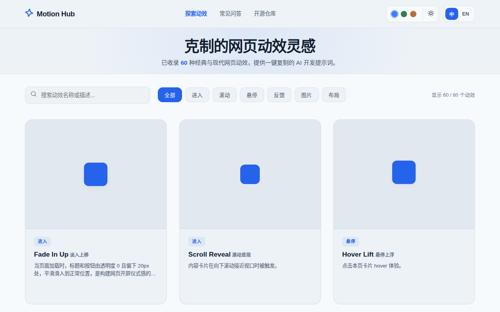
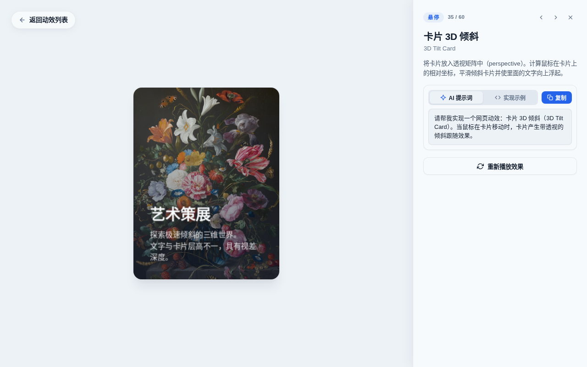

<p align="right"><a href="README.md">中文</a></p>

<p align="center">
  
</p>

<p align="center">
  <a href="https://holynova.github.io/web-motion-showcase/">▶ Browse Online</a>
  ·
  <a href="https://github.com/holynova/web-motion-showcase">GitHub Repository</a>
</p>

Web Motion Showcase is a dependency-free gallery of 60 restrained, reusable Web UI motions for designers and frontend developers. Every motion comes with a live preview, a full-screen interactive sandbox, bilingual notes, and a copy-ready AI prompt — hand it to Claude, Cursor, DeepSeek, or ChatGPT and reproduce the effect.

## Screenshots

<p align="center">
  
</p>

<p align="center">
  
</p>

## Catalog

60 motions in 6 categories (counts from `data/motions.js`):

| Category | Count | Interaction problems to watch for |
| :--- | :---: | :--- |
| 进入 (Entrance) | 12 | First-screen reveals, content loading, text entrances |
| 滚动 (Scroll) | 8 | Reading progress, parallax, narrative pacing |
| 悬停 (Hover) | 12 | Clickability, focus, pointer feedback |
| 反馈 (Feedback) | 19 | Click states, notifications, success and error |
| 图片 (Image) | 4 | Image loading, masks, texture changes |
| 布局 (Layout) | 5 | Grid reflow, card stacking, spatial transitions |

The homepage supports search (`?q=card`) and category filtering (`?filter=滚动`, the Chinese category name); detail pages flip through by index (e.g. 35 / 60).

## Features

- **Interactive sandboxes**: open any motion for a full-screen, genuinely interactive experience (hover, click, and scroll all respond for real), with replay.
- **AI prompts**: each motion ships with bilingual (Chinese + English) copy-ready prompts; the detail page also has an 「实现示例」 ("Implementation Example") to compare against code.
- **3 themes × light/dark modes**: Slate, Sage Green, and Warm Sand, each with light and dark modes, switchable in one click at the top right.
- **Bilingual interface**: switch the UI language (`?lang=zh` / `?lang=en`); motion names and notes are bilingual.
- **Accessibility**: respects `prefers-reduced-motion`, degrading automatically when the user asks for reduced motion; responsive on mobile.

## Quick Start

No build step, zero third-party runtime dependencies:

```bash
npm run dev
# Open http://127.0.0.1:4173/index.html
# Or: python3 -m http.server 4173 --bind 127.0.0.1
```

URL parameters: `?lang=zh` (language) · `?theme=slate` (theme: slate / green / sand) · `?mode=light` (mode: light / dark) · `?filter=滚动` (category) · `?q=card` (search). Detail page example: `detail.html?id=tilt-card&lang=zh&theme=slate&mode=light`.

## Tech

- Vanilla HTML + CSS + JS, zero build, zero dependencies; `data/motions.js` is the single source of truth for all 60 motions (each with bilingual names, notes, prompts, and a render function).
- Catalog consistency checks: `npm test` (`node scripts/sync-catalog.mjs`) verifies motion ID uniqueness, metadata completeness, and catalog counts.
- Pages include Schema.org JSON-LD (`ItemList`, `FAQPage`); see [`docs/GEO_OPTIMIZATION_REPORT.md`](./docs/GEO_OPTIMIZATION_REPORT.md) for GEO notes.

```
index.html                  Homepage catalog
detail.html / detail.js     Motion detail sandbox
data/motions.js             Single source of truth for motions (60)
data/translations.js        Bilingual UI translations
script.js                   Homepage interactions and filtering
css/                        Homepage component and preview styles
detail.css                  Detail page and sandbox styles
scripts/sync-catalog.mjs    Catalog consistency check
docs/screenshots/           Historical screenshots (kept)
```
