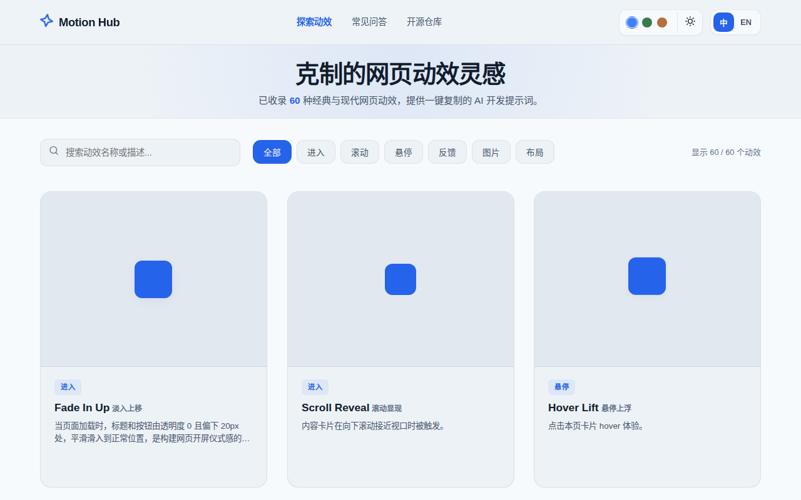

<p align="right"><a href="README.en.md">English</a></p>

<p align="center">
  
</p>

<p align="center">
  <a href="https://holynova.github.io/web-motion-showcase/">▶ 在线浏览</a>
  ·
  <a href="https://github.com/holynova/web-motion-showcase">GitHub 仓库</a>
</p>

Web Motion Showcase 是一个纯原生的网页动效灵感库：60 个克制、可复用的 Web UI 动效，面向网页设计师和前端开发者。每条动效都有首页预览、全屏交互沙盒、中英双语说明和一键复制的 AI 开发提示词——看到喜欢的动效，直接把提示词交给 Claude、Cursor、DeepSeek 或 ChatGPT 就能复现。

## 截图

<p align="center">
  
</p>

<p align="center">
  
</p>

## 动效目录

60 条动效，分 6 类（数量按 `data/motions.js` 实数）：

| 分类 | 数量 | 适合观察的交互问题 |
| :--- | :---: | :--- |
| 进入 | 12 | 首屏显现、内容加载、文字入场 |
| 滚动 | 8 | 阅读进度、视差、叙事节奏 |
| 悬停 | 12 | 可点击性、聚焦、指针反馈 |
| 反馈 | 19 | 点击状态、通知、成功与错误 |
| 图片 | 4 | 图片加载、遮罩、质感变化 |
| 布局 | 5 | 网格重排、卡片层叠、空间切换 |

首页支持搜索（`?q=card`）与分类筛选（`?filter=滚动`）；详情页按 `35 / 60` 这样的序号前后翻页。

## 功能

- **交互沙盒**：点进任意动效，全屏可交互体验（悬停、点击、滚动都真实响应），可重播效果。
- **AI 提示词**：每条动效配中英双语提示词，一键复制；详情页另有「实现示例」可对照代码。
- **三主题 × 深浅模式**：Slate、Sage Green、Warm Sand 三组主题，各有浅色与深色模式，右上角一键切换。
- **中英双语界面**：界面语言可切（`?lang=zh` / `?lang=en`），动效名称与说明均为双语。
- **无障碍**：支持 `prefers-reduced-motion`，用户设置减少动态效果时自动降级；移动端自适应。

## 快速开始

零构建，零第三方运行时依赖：

```bash
npm run dev
# 打开 http://127.0.0.1:4173/index.html
# 或：python3 -m http.server 4173 --bind 127.0.0.1
```

URL 参数：`?lang=zh`（语言）· `?theme=slate`（主题：slate / green / sand）· `?mode=light`（模式：light / dark）· `?filter=滚动`（分类）· `?q=card`（搜索）。详情页示例：`detail.html?id=tilt-card&lang=zh&theme=slate&mode=light`。

## 技术

- 纯原生 HTML + CSS + JS，零构建、零依赖；`data/motions.js` 是动效的单一数据源（60 条，每条含中英名称、说明、提示词与渲染函数）。
- 目录一致性检查：`npm test`（`node scripts/sync-catalog.mjs`）校验动效 ID 唯一性、元数据完整性与目录数量。
- 页面含 Schema.org JSON-LD（`ItemList`、`FAQPage`），GEO 相关说明见 [`docs/GEO_OPTIMIZATION_REPORT.md`](./docs/GEO_OPTIMIZATION_REPORT.md)。

```
index.html                  首页目录
detail.html / detail.js     动效详情沙盒
data/motions.js             动效单一数据源（60 条）
data/translations.js        界面双语翻译
script.js                   首页交互与筛选
css/                        首页组件与预览样式
detail.css                  详情页与沙盒样式
scripts/sync-catalog.mjs    目录一致性检查
docs/screenshots/           历史截图（保留）
```
